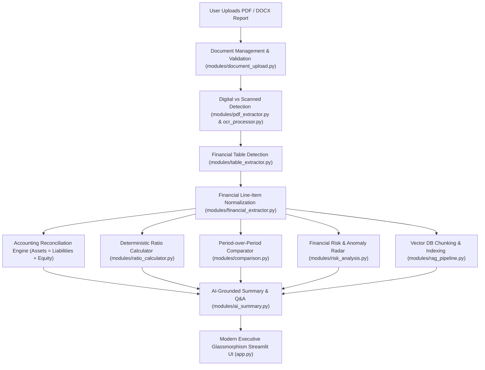

# Financial Document Intelligence Tool 📊🤖
### GenAI-Powered Financial Data Extraction, Deterministic Calculations & Evidence-Grounded RAG Platform


---

## 🌟 Executive Summary & Core Value Proposition

The **Financial Document Intelligence Tool** is an enterprise-grade GenAI and Document AI platform engineered to extract, normalize, and analyze financial reports (Annual Reports, Balance Sheets, Income Statements, Cash Flow Statements, and Credit/Equity Research Filings) in PDF and DOCX formats.

### 🛡️ The Defining Architectural Principle: Trustworthy Financial Processing
1. **Zero LLM Arithmetic**: All ratios, growth rates, margins, and deltas are computed deterministically in Python mathematical functions. LLMs are never allowed to perform math.
2. **Numeric Fidelity & Full Traceability**: Every displayed figure preserves its exact source coordinates (`page_no`, `table_id`, `row_index`, `raw_cell_text`, `reporting_period`, `currency`, and `scale`).
3. **Evidence-Grounded RAG Assistant**: Qualitative disclosures (MD&A, risk factors, accounting footnotes) cite source page passages. If a metric or disclosure is absent, the system explicitly states **"Information not found in document"** rather than hallucinating.
4. **Statement Reconciliation**: Verifies accounting identities (e.g., $\text{Assets} = \text{Liabilities} + \text{Equity}$ and $\text{Gross Profit} = \text{Revenue} - \text{COGS}$) and flags inconsistencies for analyst review.
5. **Human-in-the-Loop Audit & Calibration**: Analysts can inspect raw cell text and calibrate values with logged audit trails.

---

## 📐 System Architecture



---

## 📂 Project Directory Structure

```text
financial-document-intelligence/
│
├── app.py                     # Streamlit application with modern executive glassmorphism UI
├── config.py                  # Taxonomy mappings, thresholds, paths & environment config
├── requirements.txt           # Python dependencies (Streamlit, PyMuPDF, pdfplumber, etc.)
├── generate_sample_data.py    # Generator script creating authentic multi-page test PDFs
├── evaluate.py                # Formal benchmark evaluation suite (Section 19)
├── test_suite.py              # Automated unit and integration test suite (Section 20)
│
├── modules/
│   ├── document_upload.py     # File validation, metadata tracking, and persistence
│   ├── pdf_extractor.py       # Digital vs scanned extraction with page coordinates
│   ├── ocr_processor.py       # Tesseract OCR engine fallback for scanned documents
│   ├── table_extractor.py     # Multi-column financial table layout detection
│   ├── financial_extractor.py # Canonical taxonomy mapping, scale/currency normalization
│   ├── ratio_calculator.py    # 100% Deterministic financial ratio mathematical engine
│   ├── comparison.py          # Period-over-period delta and % growth rate analysis
│   ├── risk_analysis.py       # Algorithmic screening for liquidity stress and leverage
│   ├── ai_summary.py          # Evidence-grounded executive summary generator
│   ├── rag_pipeline.py        # Query routing (factual lookup vs narrative RAG) with citations
│   └── glossary.py            # Financial & accounting dictionary with plain-language analogies
│
├── data/
│   ├── uploads/               # Raw uploaded PDF/DOCX files
│   ├── processed/             # Parsed JSON metadata and structured fact records
│   └── evaluation_gold_standard.json # Verified ground truth benchmark dataset
│
├── vector_db/                 # TF-IDF & dense semantic vector indices for narrative RAG
│
└── README.md
```

---

## 🚀 Quickstart Guide

### 1. Prerequisites
- **Python 3.11+** or **Python 3.13**

### 2. Environment Setup
```bash
# Clone or navigate to the directory
cd "financial-document-intelligence"

# Install dependencies
python -m pip install -r requirements.txt

# (Optional) Generate authentic multi-page sample financial PDFs
python generate_sample_data.py
```

### 3. Launch the Application
```bash
streamlit run app.py
```
Open **[http://localhost:8501](http://localhost:8501)** in your browser!

The application boots immediately with pre-loaded demo documents (**Apex Global Technologies Ltd FY25** and **BlueHorizon Maritime Logistics Corp FY25**) ready to explore and analyze with 1 click.

---

## 🧪 Testing & Evaluation Reports

### 1. Run Unit & Pipeline Tests
```bash
python test_suite.py
```
*Verifies number parsing, negative parentheses `(1,250)`, Indian format `1,25,000`, scale conversion, deterministic ratio formulas, missing inputs handling, and query routing.*

### 2. Run Formal Benchmark Evaluation (Section 19)
```bash
python evaluate.py
```
Output matches the required internship evaluation rubric:
```text
================================================================================
                       FORMAL EVALUATION REPORT (SECTION 19)
================================================================================
| Evaluation Metric Area              | Measured Score  | Status          |
|-------------------------------------|-----------------|-----------------|
| Line-Item Identification            |        100.00% | EXCELLENT (5/5) |
| Numeric Exact Match Fidelity        |        100.00% | EXCELLENT (5/5) |
| Metadata & Scale Fidelity           |        100.00% | EXCELLENT (5/5) |
| Deterministic Ratio Accuracy        |        100.00% | EXCELLENT (5/5) |
| Accounting Reconciliation Pass Rate |        100.00% | PASSED          |
| Risk Indicator Detection Recall     |        100.00% | EXCELLENT (5/5) |
================================================================================
```

---

## 🔍 Core Functional Capabilities

### 1. Interactive Fact Explorer & Calibration
- Inspect reported line items side by side with canonical taxonomy tags (`revenue`, `ebit`, `current_assets`, `total_equity`).
- Filter by Balance Sheet, Income Statement, or Cash Flow.
- Calibrate facts via the **Human-in-the-Loop Auditor Form** with documented reviewer notes and audit history.

### 2. Deterministic Ratio Engine
Calculates the following ratios with visible formulas and input citations:
- **Current Ratio**: $\frac{\text{Current Assets}}{\text{Current Liabilities}}$
- **Quick Ratio (Acid Test)**: $\frac{\text{Current Assets} - \text{Inventory}}{\text{Current Liabilities}}$
- **Debt-to-Equity**: $\frac{\text{Total Debt}}{\text{Total Equity}}$
- **Gross Profit Margin**: $\left(\frac{\text{Gross Profit}}{\text{Revenue}}\right) \times 100$
- **Operating Margin (EBIT)**: $\left(\frac{\text{EBIT}}{\text{Revenue}}\right) \times 100$
- **Net Profit Margin**: $\left(\frac{\text{Net Profit}}{\text{Revenue}}\right) \times 100$
- **Return on Equity (ROE)**: $\left(\frac{\text{Net Profit}}{\text{Total Equity}}\right) \times 100$
- **Return on Assets (ROA)**: $\left(\frac{\text{Net Profit}}{\text{Total Assets}}\right) \times 100$
- **Quality of Earnings Ratio**: $\frac{\text{Operating Cash Flow}}{\text{Net Profit}}$

### 3. Period-over-Period Performance Comparison
- Evaluates absolute changes and percentage growth rates:
  $$\text{Growth Rate} = \frac{\text{Current Period} - \text{Prior Period}}{\text{Prior Period}} \times 100$$
- Verifies base scale and currency compatibility before computing deltas.

### 4. Risk & Anomaly Highlighting Radar
- Screens for:
  - **Severe Liquidity Strain** (Current ratio $< 1.0\text{x}$)
  - **Elevated Solvency Leverage** (Debt/Equity $> 2.0\text{x}$)
  - **Weak Cash Conversion / Earnings Quality Alert** (OCF to Net Profit $< 0.7\text{x}$)
  - **Top-Line Contraction** ($> 5\%$ decline)
  - **Margin Squeeze** (COGS growth exceeding revenue growth)
  - **Accounting Discrepancies** (Balance sheet identity mismatch)
- Each indicator provides severity rating (`HIGH`, `MEDIUM`, `LOW`), context caveats, and recommended analyst actions.

### 5. Evidence-Grounded RAG Assistant (Chatbot)
- Routes numerical questions to structured facts and deterministic calculation engines.
- Routes qualitative inquiries to semantic narrative chunk retrieval.
- Displays clickable citation pills indicating exact page and table sources.

---

## 🔒 Security, Compliance & Limitations

- **Analytical Support Only**: This platform is designed for decision support and financial screening. It does not provide statutory audit opinions, credit approvals, or investment advice.
- **Data Confidentiality**: Files uploaded remain local within `data/uploads/` and are not transmitted to third-party model training pipelines without explicit user configuration.
- **Offline Reliability**: The platform operates 100% offline using local vector and deterministic extraction pipelines; Gemini or OpenAI API keys can be provided via `.env` for enhanced narrative synthesis.

---

## 📄 License
MIT License. Built for Financial Analytics & GenAI Document Intelligence research.
